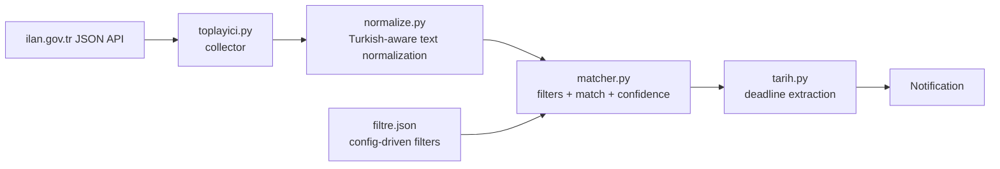
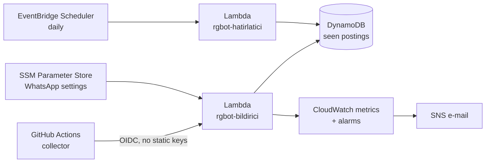

# rg-ilan-botu

> **Status: Stopped (November 2026).** The ilan.gov.tr search API began returning 403 to GitHub Actions on 2026-09-24, and the publishing authority does not permit automated use of portal content, so the bot was shut down instead of being worked around. What happened, why it went unnoticed for 46 days, and what changes in the next version: [POSTMORTEM.md](POSTMORTEM.md) (Turkish). Scheduled workflows are disabled; the code is kept as-is. The successor will be a separate Java/Spring project with a swappable data source, using this repo as its working specification.

**Job-posting alert system for Turkey's Official Gazette (Resmî Gazete).**
Monitored official announcements for *Physiotherapy & Rehabilitation research assistant* positions and notified a single user over Telegram — instead of someone manually checking a government PDF every morning.

> **Data source note:** the project originally parsed Resmî Gazete HTML/PDFs directly. RG blocked the cloud IP ranges the bot ran on, so the live pipeline was migrated to the **ilan.gov.tr JSON API**, which publishes the same announcements. That API has been closed to the bot since 2026-09-24 (see [POSTMORTEM.md](POSTMORTEM.md)). The RG-specific modules (`fetcher.py`, `pdftext.py`, `segment.py`, `backfill.py`) are kept as a tested reference implementation but were not on the live path.

## Architecture

**Pipeline (as it ran until shutdown):**



**AWS side (`infra/main.tf`):** collection ran on GitHub Actions (hourly cron in `.github/workflows/tarama.yml`); the AWS side handled de-duplication, metrics and alarms.



Telegram notifications were sent directly from the Actions job (`src/rgbot/telegram.py`).

## Key design decision: segment-based matching

A single Gazette document can contain **multiple independent job postings**. `tests/fixtures/kmu_20260416.txt` is a real example: one file contains both a research assistant posting *and* a faculty posting that mentions physiotherapy. Searching the document as a whole would produce a false positive; splitting on posting codes (e.g. `3795/1-1`) and matching per segment correctly yields zero matches for that file.

Both behaviors are proven in tests:
`test_segmentasyonsuz_yanlis_alarm_verirdi` (whole-document search would false-alarm) vs. `test_segmentli_dogru_sonuc_sifir_eslesme` (segmented search is correct).

Other things Turkish text makes non-trivial (all covered by tests):

- **İ/ı casing trap** — Python's default `.lower()` breaks Turkish; normalization handles it explicitly
- Line-break healing and abbreviation variants (`Arş. Gör.` / `Arş.Gör.`)
- **Exclusion logic** — "Fiziksel Tıp ve Rehabilitasyon" (a medical specialty) must *not* match "Fizyoterapi ve Rehabilitasyon"
- Application-deadline extraction from the posting text, with a 15-day fallback

## Config-driven filters (no redeploy needed)

`filtre.json`:

```json
{
  "pozisyon": ["Araştırma Görevlisi", "Arş. Gör.", "Arş.Gör."],
  "alan": ["Fizyoterapi", "Fizik Tedavi ve Rehabilitasyon"],
  "disla": ["Fiziksel Tıp ve Rehabilitasyon"],
  "arama": ["fizyoterapi", "fizik tedavi"]
}
```

Changing what the bot looks for is a JSON edit, not a code change. The live pipeline read this file from the repo (`RGBOT_FILTRE_JSON` in `tarama.yml`). Loading is covered by `test_filtre_json_yukleme`.

## Setup

```bash
python3 -m venv .venv && source .venv/bin/activate   # Windows: .venv\Scripts\activate
pip install -r requirements.txt
pip install -e .
python -m pytest
```

`pip install -e .` registers the package, so the `rgbot-backfill` CLI works from any directory.

> The data source is currently closed to automated access, so the collector (`python -m rgbot.toplayici`) will not return data. The tests run on local fixtures and mocks and do not call ilan.gov.tr.

## Backfill: scanning a year of history

```bash
rgbot-backfill --baslangic 2025-08-01 --bitis 2026-08-01 --cikti tarama/
```

- Waits 1s between requests; ~250 business days take a few hours
- Resumable — re-running the same command skips already-downloaded documents
- Output: `tarama/rapor.csv` (one row per document) and `tarama/eslesmeler.jsonl` (matched segments with details)

The backfill answers three questions: how often the target posting actually appears, the filter's false-positive rate, and which real positives should be promoted into `tests/fixtures/` to grow the regression golden set.

## Project layout

```
src/rgbot/
  toplayici.py   live collector (ilan.gov.tr API)
  ilanapi.py     API client
  normalize.py   Turkish-aware normalization (foundation for everything)
  matcher.py     filters + matching + confidence (KESIN / SUPHELI)
  tarih.py       deadline extraction
  segment.py     posting-code segmentation      (RG legacy, tested)
  pdftext.py     pdfplumber text/table layer    (RG legacy, tested)
  fetcher.py     index discovery + download     (RG legacy, cp1254!)
  backfill.py    historical scan CLI
infra/           Terraform for the AWS side (Lambda, DynamoDB, alarms, OIDC role)
tests/           unit tests + real-document fixtures
```

## Roadmap (closed)

Development in this repo has stopped. The original list, with where each item ended up:

1. Filter tuning based on backfill results — not done
2. Terraform — `infra/main.tf` defines Lambda (zip + layer, not a container), DynamoDB, SSM, EventBridge Scheduler and SNS; no S3
3. WhatsApp Cloud API integration — client code in `src/rgbot/whatsapp.py`; notifications actually went out over Telegram
4. Dead-man's-switch alarms (PageFound / PdfCount metrics) — defined in `infra/main.tf`; why they did not catch the September outage is explained in [POSTMORTEM.md](POSTMORTEM.md)
5. Reminder Lambda (3 days before the application deadline) — `rgbot-hatirlatici` in `infra/main.tf`
